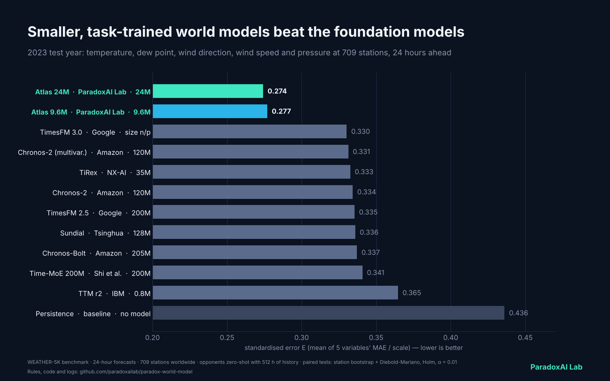

# Paradox World Model (PWM)

**ParadoxAI Lab** · [paradoxailab.com](https://paradoxailab.com) · contact.paradoxailab@gmail.com · Authors: Aditya Kumar, Anupam Singh

Compact physical world models for station weather, air quality, traffic and rainfall, trained from scratch on public
data and scored against the strongest public forecasting models on identical windows with paired significance tests.
Every rule and prediction is committed here **before** the run it governs, and every number below is copied from a
result file in this repository.

## Latest: Atlas-5K 10M and 25M on WEATHER-5K (2026-11-19)

Atlas-5K is a station-graph world model. Each station reads its last 48 hours together with its 31 nearest
neighbours; the model encodes them into a latent state and rolls the state forward with one shared transition and
attention biased by geometry. We grew an adopted 0.97M model twice with exact, function-preserving maps (same forecasts
at the start of training), to **9.64M** and then **24.1M** parameters ("10M" and "25M" below), and trained on.

* **Head-to-head on 709 stations, 24 h ahead:** both models win **all 50** opponent × variable comparisons against
  nine foundation-model configurations (TimesFM 2.5 and 3.0, Chronos-2 uni- and multivariate, Chronos-Bolt, TiRex,
  Sundial, Time-MoE 200M, TTM r2) and persistence, on the 2023 test year **and** on 19 months of fresh NOAA observations
  (January 2024 – August 2025), after the benchmark ends, which Atlas never saw. The foundation models' training corpora are not fully documented; any overlap with these years or with 2023 would favour them, not Atlas. Largest Holm-adjusted p = 0.005.
* **Margin:** the 25M's combined error E is **17.0% below** the best foundation model, TimesFM 3.0 (0.2742 vs 0.3303),
  with 5.0–8.5× fewer parameters than Chronos-2 (120M), Sundial (128M), TimesFM 2.5 (200M), Time-MoE (200M) and Chronos-Bolt (205M); the 10M has 12–21× fewer and is 16.1% below TimesFM 3.0.
* **Full 2023 test** (all 5,672 stations, every hour): the 25M has lower error than **PhysicsFormer** (19.3M, the
  benchmark's best published model) on 4 of 5 variables, **not on sea-level pressure** (+3.0%), and lower error than the
  **ECMWF-HRES** forecast at stations on 4 of 5, **far worse on pressure** (+71%).
* **What size bought:** 10× the parameters (1M → 10M) gave −1.95% validation error; another 2.5× (10M → 25M) gave
  −1.03%, adopted by a margin of 0.00009 in E, with one seed, and no significant gain on pressure.

Paper (NeurIPS format, 16 pages with appendix, proofs, full paired tables, every prediction and the checklist): [`atlas/paper4/Atlas5K_growth_preprint.pdf`](atlas/paper4/Atlas5K_growth_preprint.pdf) ·
rules, predictions and full record: [`atlas/README.md`](atlas/README.md) ·
model card: [`atlas/MODELS.md`](atlas/MODELS.md) ·
raw outputs: [`atlas/results/colab/atlas5k_grown/`](atlas/results/colab/atlas5k_grown) ·
charts: [`atlas/paper4/social/`](atlas/paper4/social)



### All results

The tables below are generated from the result files by
[`atlas/paper4/make_tables.py`](atlas/paper4/make_tables.py); nothing is typed by hand. Foundation models are run
zero-shot with 512 hours of history (Atlas uses 48) and scored by their median forecast on identical windows.

**2023 test** (709 stations, 182 forecast starts from 2023-01-03 to 2023-12-31, 24 h each; up to 3,096,912 scored values per variable; hours with no observation are not scored). E = standardised mean error, lower is better.

| Rank | Model | Params | E | Temp. (°C) | Dew pt. (°C) | Wind dir. (°) | Wind spd. (m/s) | Pressure (hPa) |
|---|---|---|---|---|---|---|---|---|
| 1 | **Atlas-5K 25M (ours)** | 24.1M | **0.2742** | 1.391 | 1.460 | 53.93 | 1.179 | 1.466 |
| 2 | Atlas-5K 10M (ours) | 9.64M | 0.2770 | 1.420 | 1.475 | 54.51 | 1.190 | 1.472 |
| 3 | Atlas-5K v2c (ours) | 0.97M | 0.2822 | 1.462 | 1.506 | 55.39 | 1.206 | 1.520 |
| 4 | TimesFM 3.0 (Google) | n/a | 0.3303 | 1.876 | 1.960 | 63.06 | 1.327 | 1.965 |
| 5 | Chronos-2 multivariate (Amazon) | 120M | 0.3313 | 1.843 | 1.920 | 62.79 | 1.335 | 2.067 |
| 6 | TiRex (NX-AI) | 35M | 0.3326 | 1.900 | 1.955 | 64.38 | 1.325 | 1.948 |
| 7 | Chronos-2 (Amazon) | 120M | 0.3343 | 1.899 | 1.965 | 63.39 | 1.349 | 2.027 |
| 8 | TimesFM 2.5 (Google) | 200M | 0.3355 | 1.968 | 1.998 | 63.80 | 1.337 | 2.014 |
| 9 | Sundial base (Tsinghua THUML) | 128M | 0.3360 | 1.923 | 2.007 | 64.09 | 1.338 | 2.028 |
| 10 | Chronos-Bolt base (Amazon) | 205M | 0.3372 | 1.897 | 2.016 | 64.40 | 1.359 | 1.990 |
| 11 | Time-MoE (Shi et al.) | 200M | 0.3408 | 1.955 | 2.037 | 65.48 | 1.363 | 1.989 |
| 12 | TTM r2 (IBM Research) | 0.8M | 0.3647 | 2.175 | 2.155 | 65.79 | 1.359 | 2.827 |
| 13 | Persistence | 0 | 0.4361 | 3.738 | 2.224 | 75.69 | 1.724 | 2.785 |

**Live, Jan 2024 – Aug 2025** (709 stations, 145 forecast starts from 2024-01-23 to 2025-08-21, 24 h each; up to 1,914,220 scored values per variable; hours with no observation are not scored). E = standardised mean error, lower is better.

| Rank | Model | Params | E | Temp. (°C) | Dew pt. (°C) | Wind dir. (°) | Wind spd. (m/s) | Pressure (hPa) |
|---|---|---|---|---|---|---|---|---|
| 1 | **Atlas-5K 25M (ours)** | 24.1M | **0.3007** | 1.421 | 1.453 | 64.38 | 1.202 | 1.624 |
| 2 | Atlas-5K 10M (ours) | 9.64M | 0.3028 | 1.448 | 1.469 | 64.76 | 1.210 | 1.623 |
| 3 | Atlas-5K v2c (ours) | 0.97M | 0.3071 | 1.487 | 1.498 | 65.40 | 1.227 | 1.655 |
| 4 | TimesFM 3.0 (Google) | n/a | 0.3508 | 1.882 | 1.952 | 71.25 | 1.353 | 2.070 |
| 5 | Chronos-2 multivariate (Amazon) | 120M | 0.3522 | 1.848 | 1.916 | 70.78 | 1.367 | 2.175 |
| 6 | Chronos-Bolt base (Amazon) | 205M | 0.3547 | 1.899 | 2.007 | 71.70 | 1.371 | 2.092 |
| 7 | TiRex (NX-AI) | 35M | 0.3558 | 1.927 | 1.955 | 73.34 | 1.357 | 2.058 |
| 8 | Chronos-2 (Amazon) | 120M | 0.3559 | 1.902 | 1.959 | 71.84 | 1.381 | 2.131 |
| 9 | Sundial base (Tsinghua THUML) | 128M | 0.3572 | 1.931 | 1.998 | 72.74 | 1.363 | 2.120 |
| 10 | TimesFM 2.5 (Google) | 200M | 0.3575 | 1.975 | 1.991 | 72.45 | 1.365 | 2.127 |
| 11 | Time-MoE (Shi et al.) | 200M | 0.3665 | 1.993 | 2.049 | 75.27 | 1.397 | 2.115 |
| 12 | TTM r2 (IBM Research) | 0.8M | 0.3829 | 2.176 | 2.120 | 74.28 | 1.375 | 2.854 |
| 13 | Persistence | 0 | 0.4646 | 3.807 | 2.178 | 87.11 | 1.778 | 2.842 |

**Paired verdicts** (station-block bootstrap, 10,000 resamples, and Diebold–Mariano; the larger p-value, Holm-corrected over the 50 opponent × variable pairs, α = 0.01):

| Our model | Period | Significant wins | Largest Holm p | Margin vs the 9 foundation models (per variable) |
|---|---|---|---|---|
| Atlas-5K 25M (ours) | 2023 test | 50/50 | 0.005 | 11.0% to 48.2% lower MAE |
| Atlas-5K 25M (ours) | Live, Jan 2024 – Aug 2025 | 50/50 | 0.005 | 9.1% to 43.1% lower MAE |
| Atlas-5K 10M (ours) | 2023 test | 50/50 | 0.005 | 10.2% to 47.9% lower MAE |
| Atlas-5K 10M (ours) | Live, Jan 2024 – Aug 2025 | 50/50 | 0.005 | 8.5% to 43.1% lower MAE |

**Against the closest opponent, TimesFM 3.0** (25M's MAE change, paired, with 95% bootstrap interval):

| Period | Temp. | Dew pt. | Wind dir. | Wind spd. | Pressure |
|---|---|---|---|---|---|
| 2023 test | -25.9% [-27.2, -24.6] | -25.5% [-26.8, -24.3] | -14.5% [-15.3, -13.7] | -11.2% [-11.9, -10.5] | -25.4% [-26.6, -24.3] |
| Live, Jan 2024 – Aug 2025 | -24.5% [-25.8, -23.2] | -25.6% [-26.8, -24.2] | -9.6% [-10.7, -8.6] | -11.1% [-11.9, -10.3] | -21.6% [-22.7, -20.4] |

**25M against 10M** (paired, same windows; Holm over the five variables):

| Period | Temp. | Dew pt. | Wind dir. | Wind spd. | Pressure | Significant |
|---|---|---|---|---|---|---|
| 2022 validation | -2.12% (p 0.0005) | -1.19% (p 0.0005) | -1.10% (p 0.0005) | -0.93% (p 0.0005) | -0.42% (p 0.0016) | 5/5 |
| 2023 test | -2.06% (p 0.0005) | -1.04% (p 0.0005) | -1.07% (p 0.0005) | -0.90% (p 0.0005) | -0.45% (p 0.017) | 4/5 |
| Live 2024–25 | -1.86% (p 0.0005) | -1.08% (p 0.0005) | -0.59% (p 0.0005) | -0.66% (p 0.0005) | +0.10% (p 0.56) | 4/5 |

**Full 2023 test** (all 5,672 stations, every hourly window, about 1.18 × 10⁹ values per variable; WEATHER-5K protocol, MAE). Published rows are from the WEATHER-5K paper, compared by number only:

| Model | Params | Temp. | Dew pt. | Wind dir. | Wind spd. | Pressure |
|---|---|---|---|---|---|---|
| **Atlas-5K 25M (ours)** | 24.1M | 1.400 | 1.468 | 53.33 | 1.173 | 1.473 |
| Atlas-5K 10M (ours) | 9.64M | 1.429 | 1.486 | 53.93 | 1.183 | 1.477 |
| Atlas-5K v2c (ours) | 0.97M | 1.474 | 1.520 | 54.84 | 1.202 | 1.533 |
| PhysicsFormer (published) | 19.3M | 1.55 | 1.59 | 57.37 | 1.21 | 1.43 |
| ECMWF-HRES at stations (published) | – | 1.76 | 1.85 | 63.8 | 1.48 | 0.86 |
| 25M vs PhysicsFormer | | -9.7% | -7.7% | -7.0% | -3.1% | +3.0% |
| 25M vs ECMWF-HRES | | -20.5% | -20.7% | -16.4% | -20.8% | +71.2% |

### What these results do not show

* **Task-trained against zero-shot.** The opponents are general models run zero-shot under their documented settings;
  none was fine-tuned on WEATHER-5K. Atlas is trained on WEATHER-5K's training years and sees its neighbours. The result
  is that a small spatial model beats general models *on this problem*, not that it is a better model in general.
* **Pressure** is the open gap: worse than PhysicsFormer (+3.0%) and far worse than ECMWF-HRES (+71%).
* **One seed** per grown model; the 25M's adoption margin is within seed noise.
* **Growth against restart** is not isolated: no 10M or 25M model was trained from scratch for comparison.
* **24 hours only.** No rainfall, no extremes, no 3–7 day horizons yet.
* **Data overlap is not excluded for the opponents.** Several foundation models were released in 2025 and their corpora may contain NOAA station data from 2023–25. That can only help them; Atlas was trained on 2014–2021 only.
* **Live-data processing differs:** the live period uses NOAA ISD-Lite, whose hourly selection is not WEATHER-5K's; every model's error rises there (E: Atlas 25M +9.7%, 10M +9.3%; the nine foundation models +5.0% to +7.5%).
* **Not compared:** Moirai, Toto, Lag-Llama, MOMENT, Birla AI Labs' Yug-1 and other models outside the ten listed.
* **Published comparisons** (PhysicsFormer, ECMWF-HRES) are by number, not paired, and use the published protocol.
* **Harness amendment:** TTM r2, Sundial and Time-MoE first failed for setup reasons; they were rerun in their
  documented setup (IBM's hourly frequency token; a Python 3.11 environment for `transformers==4.40.1`), recorded in
  commit `ab4726c` before the reruns. No other change.

### How the results were kept honest

| When (UTC) | Commit | What was fixed before the result existed |
|---|---|---|
| 2026-11-16 23:52 | `84e14b9` | 10M rules and predictions, before any run |
| 2026-11-17 02:56 | `e09e239` | 10M adopted; scored once on the 2023 test |
| 2026-11-17 09:03 | `9d5f778` | Head-to-head rules, opponents, tests and predictions, before any opponent score |
| 2026-11-17 09:27 | `3e03ed2` | Amendment before any opponent score: every 8th station, every 2nd day (cost) |
| 2026-11-17 12:33 | `f9be24d` | 2023 test and live-data rules, before running |
| 2026-11-17 14:44 | `79227ce` | Live-data fetch amendment, before any live score |
| 2026-11-17 17:33 | `2b1950e` | 25M rules and predictions, four new opponents, live-data rebuild with identity check, before any run |
| 2026-11-18 09:57 | `396433f` | 25M training and adoption (validation only) |
| 2026-11-18 11:48 | `ab4726c` | Harness fixes for TTM, Sundial, Time-MoE, before their reruns |
| 2026-11-18 17:39 | `a8d51fb` | 25M 2023 test and full head-to-head; every prediction scored, including the failures |
| 2026-11-18 19:56 | `9cf5893` | Models released |

Predictions: for the 25M, 6 of 7 held (the failed one gave adoption only 35%). For the 10M, all 8 training and test
predictions held; its head-to-head prediction "smallest margin on pressure" failed (it was wind speed).
One correction since release: the 25M's validation E is 0.27307 (the result file), not 0.27308 as first written;
the validation pass ran twice and the two passes differ in the fifth decimal (see `atlas/README.md`).

## Models

All released weights are in [`models/series/`](models/series) (56 files, 508.6 MB, SHA-256 in `SHA256SUMS`, index in
`SERIES.json`).
The same 56 models are on **Hugging Face** at [huggingface.co/paradoxailab](https://huggingface.co/paradoxailab), one repository per model with its model card, oldest first in the index [paradoxailab/paradox-world-model-series](https://huggingface.co/paradoxailab/paradox-world-model-series); every uploaded file's SHA-256 was checked against `SHA256SUMS` after upload. Each file holds the weights, the configuration, the dataset name and every result for that model.
The Atlas-5K line:

| # | File | Params | Size | 2023 test E (h2h) | Status |
|---|---|---|---|---|---|
| 57 | `57_atlas-5k_v2c_weather5k_adopted.pt` | 968,672 | 3.9 MB | 0.2822 | parent of #58 |
| 58 | `58_atlas-5k-10m_weather5k_adopted.pt` | 9,639,780 | 38.7 MB | 0.2770 | adopted, grown into #59 |
| 59 | `59_atlas-5k-25m_weather5k_adopted.pt` | 24,103,796 | 96.5 MB | **0.2742** | adopted, current entry |

```python
import sys, torch
sys.path.insert(0, "atlas")                       # the repo's atlas/ folder holds the atlas package
from atlas.model import Atlas
ck = torch.load("models/series/59_atlas-5k-25m_weather5k_adopted.pt", map_location="cpu", weights_only=False)
model = Atlas(**{k: v for k, v in ck["cfg"].items() if k != "grown_from"})
model.load_state_dict(ck["weights"]); model.eval()
print(ck["meta"]["result"])                       # results are inside the file
# q, recon, extras = model(yc, mc, uc, uf, geo, None, static)
# q: [batch, 32 stations, 24 hours, 5 variables, 3 quantiles (10/50/90%)]; the median q[..., 1] is the forecast.
```

Build the inputs exactly as [`atlas/delhi/run_atlas_5k.py`](atlas/delhi/run_atlas_5k.py) does (benchmark scaling,
`neighbours()`, `geometry()`). The 25M file is an ordinary Git file of 96.5 MB; a full clone downloads about 0.5 GB.

## Reproduce

| Step | Where |
|---|---|
| Train the 10M / 25M (Colab, one A100 or L4) | [`atlas/notebooks/atlas_10m_colab.ipynb`](atlas/notebooks/atlas_10m_colab.ipynb), [`atlas/notebooks/atlas_25m_colab.ipynb`](atlas/notebooks/atlas_25m_colab.ipynb) |
| Growth maps | [`atlas/atlas/grow.py`](atlas/atlas/grow.py) |
| Training, adoption rule, single 2023 test | [`atlas/delhi/run_atlas_5k.py`](atlas/delhi/run_atlas_5k.py) |
| Opponents and head-to-head scoring | [`atlas/delhi/score_tsfm_w5k.py`](atlas/delhi/score_tsfm_w5k.py), [`atlas/delhi/pw/opponents.py`](atlas/delhi/pw/opponents.py) |
| Paired tests (bootstrap, Diebold–Mariano, Holm) | [`atlas/delhi/paired_w5k.py`](atlas/delhi/paired_w5k.py) |
| Live NOAA data | [`atlas/delhi/tools/fetch_isd_live.py`](atlas/delhi/tools/fetch_isd_live.py) |
| Paper tables and figures | [`atlas/paper4/make_tables.py`](atlas/paper4/make_tables.py), [`atlas/paper4/figs4.py`](atlas/paper4/figs4.py) |

Cost of the 25M round: about 6 L4-hours of training plus 7.5 A100-hours of evaluation (Time-MoE alone 4.8 h).
WEATHER-5K and NOAA data are downloaded by the scripts and are not redistributed here.

## Repository map

| Path | What it is |
|---|---|
| [`atlas/`](atlas) | **Current work.** The Atlas model family: code (`atlas/atlas/`), experiments and scorers (`atlas/delhi/`), notebooks, papers (`paper` India, `paper2` Atlas-F, `paper3` 10M, `paper4` 10M and 25M), results, model card, threshold functions |
| [`models/series/`](models/series) | Every released model, numbered 01–59, with its dataset and results inside |
| [`atlas/results/`](atlas/results) | Raw run outputs (logs, result JSON) from Colab and Kaggle |
| [`PWM-Dyn_ParadoxBench.md`](PWM-Dyn_ParadoxBench.md) | The earlier front page: PWM-Dyn v0.3–v0.7 and the ParadoxBench traffic and rainfall benchmark |
| [`v0.3-colab/`](v0.3-colab), [`v0.4-paradoxbench/`](v0.4-paradoxbench), [`v0.6-conference/`](v0.6-conference), [`v0.7-realworld/`](v0.7-realworld) | PWM-Dyn versions and ParadoxBench (traffic, IMD rainfall) |
| `delhi-v0.3` … `delhi-v2.0`, `india-v2.0` | PWM-W / PWM-X weather and Delhi air-quality versions |
| [`paper/`](paper), [`paper-conference/`](paper-conference), [`paper-weather/`](paper-weather) | Papers for PWM-Dyn / ParadoxBench and PWM-W |
| [`results/`](results) | ParadoxBench leaderboards and scored rows |
| [`RESULTS.md`](RESULTS.md) | PWM-Dyn and ParadoxBench results with provenance |
| [`DATA_SOURCES.md`](DATA_SOURCES.md) | Every dataset, its terms and how it is downloaded |

Earlier Atlas results (India air quality with real ECMWF forecasts, threshold functions, Atlas-F) are summarised in
[`atlas/README.md`](atlas/README.md) and [`atlas/THRESHOLD_FUNCTIONS.md`](atlas/THRESHOLD_FUNCTIONS.md).

## Licence and citation

Code and our model weights: Apache-2.0 (see [LICENSE](LICENSE)). Data keep their original terms (see
[DATA_SOURCES.md](DATA_SOURCES.md)). TimesFM 3.0 (non-commercial research licence) and TiRex (NXAI community licence)
were used for evaluation only and are not distributed here. Please cite with [CITATION.cff](CITATION.cff).
